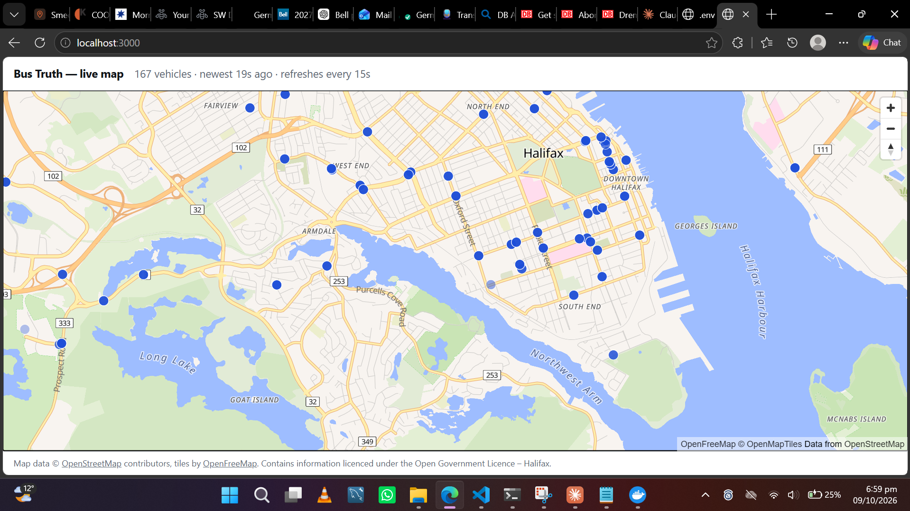

# Bus Truth



Bus Truth measures how reliable Halifax Transit actually is. It records the agency's
live GTFS-Realtime feeds every 20 seconds and keeps every snapshot forever, derives
from those positions the moment each bus reached each stop, compares that against the
timetable published for that day, and publishes the gap.

Both sides of the comparison are the agency's own data. Nothing here is a survey or an
estimate of how a journey felt.

> Contains information licenced under the Open Government Licence – Halifax.

## What this measures, and what it cannot

**It measures:** on-time performance per route, per hour of the local day, per service
date and per stop, against the schedule publication in force on that date; the delay
distribution behind each percentage; and its own collection coverage, day by day.

**It cannot measure what the feed does not show, and that is the central limitation.**
Halifax reports a bus's stop number about **6.8 times across a 38.3-stop trip**, so
roughly **17.5%** of scheduled stop-events have an observed arrival. The other 82.5%
were served and never mentioned. They are counted, never interpolated, and never
reported as missed service.

Two further honest limits, both measured and both below in [data
quality](#data-quality): the published figure moves **17.5 percentage points** on our own
definition of the moment of arrival — a different 17.5 from the coverage share above,
unfortunately — and carries an **8.7-point** margin of error once that definition was
settled. The two data sources also disagree about stop numbering on **21.5%** of
arrivals.

**And the figure worth reading first:** the buses themselves vary by more than any of
that — 21.3 points between the best and worst day of the week, 34.1 between the best and
worst hour of the day. See [findings](#findings).

Bunching, ghost buses and prediction accuracy are designed and not built. Prediction
accuracy needs the trip-updates loader, which is sized and deferred for a measured
reason — see [what is not built](#what-is-not-built).

## Architecture

```
gtfs.halifax.ca ──[HTTP, every 20s]──► collector (Java) ──► data/raw/*.pb.gz   the archive, forever
                                            │
                                            └────────────► PostgreSQL          raw_vehicle_positions
static GTFS zip ──[Python]───────────────────────────────► PostgreSQL          gtfs_* tables

PostgreSQL ──► processor (Java) ──► arrival_events ──► ontime_events
                                                            │
                                                api (Spring Boot)
                                                            │
                                      web (Vite + React + React Router)
```

There is no queue. One was removed, with its reasoning kept: see
[ADR-012](docs/decisions/012-replace-streaming-with-batch.md).

| module | what it does |
|---|---|
| `common` | shared immutable records — the shapes the services agree on |
| `collector` | polls the three feeds, archives the raw bytes, writes `raw_*` tables, owns the Flyway schema, and replays the archive into the database |
| `processor` | positions → `arrival_events` → `ontime_events`, re-runnable per date range |
| `api` | six REST endpoints plus OpenAPI |
| `web` | five pages: live map, leaderboard, route, stop, method |
| `scripts` | `save_feeds.py` (the standalone archiver), `load_gtfs.py`, join and fixture checks |
| `infra` | compose for local PostgreSQL, and the production stack |
| `docs` | decision records, stage write-ups, deployment, defence notes |

Every non-trivial choice is recorded in [docs/decisions](docs/decisions/). The ones
marked **NEEDS DANIEL'S REVIEW** were written to unblock the build and are still to be
rewritten by their author.

## Running it

Requires Docker, JDK 21 and Node 24.

```bash
cp .env.example .env                  # then set a local password
docker compose -f infra/docker-compose.yml up -d --wait

# PostgreSQL is published on 55432, not 5432 — see docs/stages/stage-3.md
psql -h localhost -p 55432 -U bustruth -d bustruth

export POSTGRES_PASSWORD=...          # no password has a default, anywhere

./mvnw -pl common -am install -DskipTests
./mvnw -f collector/pom.xml spring-boot:run      # :8081 — polls, archives, migrates
python scripts/load_gtfs.py                      # the published schedule
./mvnw -f api/pom.xml spring-boot:run            # :8084

cd web && npm ci && npm run dev                  # :5173, /api proxied to :8084
```

Deriving the measurements for a date range, from positions already collected:

```bash
./mvnw -pl common,processor -am package -DskipTests
java -jar processor/target/processor-0.1.0-SNAPSHOT.jar     --server.port=0 --from=2026-10-04 --to=2026-10-10     # detection, then on-time
```

If the database is emptier than the archive — which it will be, if collection ran
before the database did — replay the archive through the live write path:

```bash
./mvnw -pl common,collector -am package -DskipTests
java -jar collector/target/collector-0.1.0-SNAPSHOT.jar     --bustruth.collector.polling-enabled=false     --backfill-from=2026-10-04 --backfill-to=2026-10-10
```

The site is at `http://localhost:5173`, the API at `http://localhost:8084/api/coverage`,
and its OpenAPI document at `http://localhost:8084/v3/api-docs`.

Tests: `./mvnw verify` runs everything, including integration tests that start a real
PostgreSQL 18 through Testcontainers, so Docker must be running. Any test that boots
the Spring context must set `bustruth.collector.polling-enabled=false` — otherwise the
pollers fetch live data and write rows underneath the test's own assertions, which is
how CI once failed with 159 rows before a replay and 233 after.

Deploying it: [docs/DEPLOY.md](docs/DEPLOY.md). PostgreSQL publishes no port there, and
[ADR-016](docs/decisions/016-how-it-is-deployed.md) says why that is a property of the
compose file rather than a value in it.

## Findings

> **NEEDS DANIEL'S REVIEW** — written by Claude Code to unblock the build. Every number
> here is measured and reproducible from the queries in `docs/decisions/`; the choice of
> what matters is his.

All figures below cover **4–10 October 2026**: 109,230 arrivals matched to a published
schedule time, derived from 1.2 million recorded vehicle positions.

### 1. The buses vary more than the methodology does

| | points |
|---|---|
| this project's margin of error after calibration | 8.7 |
| gap between the two candidate definitions of "arrived" | 17.5 |
| **spread between the best and worst day of the week** | **21.3** |
| **spread between the best and worst hour of the day** | **34.1** |

Days went into settling choices worth 8.7 and 17.5 points. The service moves more than
that between a Tuesday and a Saturday, and more again between 06:00 and 17:00. This is
the frame every caveat in this project should be read in.

**They are not like-for-like.** 8.7 and 17.5 are systematic shifts that move every row
the same way; 21.3 and 34.1 are max-minus-min ranges over seven days and twenty-two
hours, which grow with the number of samples and are driven by extremes. Compare them
for scale, not as equivalents.

### 2. When you travel matters more than which route you take

On-time performance tracks the road, hour by hour: **79.4% at 06:00 against 45.3% at
17:00**, with the median arrival going from 37 seconds late to 267. The mechanism is
congestion, and it is the strongest pattern in the data.

### 3. The ferry is the natural experiment

| | arrivals | on time | hour-standardised | median delay |
|---|---|---|---|---|
| **Ferries** | 79 | **97.5%** | 98.2% | +82s |
| Local routes | 105,375 | 60.6% | 60.5% | +124s |
| Express routes | 3,776 | 48.0% | **55.6%** | +245s |

The ferry runs all day, does not share a road with cars, and is on time **97.5% of 79
arrivals** against 60.1% for the network. That gap is far too large to be a scheduling
artefact, and it isolates the mechanism the rest of these findings point at: the thing
degrading Halifax Transit's punctuality is road traffic.

**The express gap is mostly the hour effect wearing a costume, and most of it does not
survive the control.** Express routes look 12.6 points worse than everything else, but
they are commuter services that run disproportionately at the worst time of day.
Standardising both to the same hour mix closes about 60% of the gap: 48.0% becomes
55.6%, against 60.5% for local routes — a residual of **4.9 points**, not 12.6.

What does survive is sharper than a mode difference. Express routes are far worse
**specifically at peak** and slightly **better** off-peak:

| hour | express | local | gap |
|---|---|---|---|
| 06:00 | 85.8% of 318 | 78.6% | **+7.2** |
| 08:00 | 34.7% of 265 | 54.1% | −19.4 |
| 09:00 | 22.5% of 80 | 55.7% | −33.2 |
| 17:00 | 30.2% of 640 | 46.5% | −16.3 |
| 23:00 | 76.7% of 60 | 76.2% | +0.5 |

An express bus is the best thing on the network at six in the morning and the worst at
nine. That is an interaction with congestion, not a property of the service type.

### 4. A leaderboard ranked on percentage alone ranks sample sizes

Queried over a single service date, the three "best" routes had **eleven, four and two**
observed arrivals and the two "worst" had one each. No percentage leaves the API without
its denominator, and nothing is ranked below 23 arrivals — see
[ADR-017](docs/decisions/017-how-few-observations-is-too-few.md).

### 5. The agency's realtime feed and its own schedule disagree about its own trips

They name the same stop for the same stop number on **78.5%** of matched arrivals; on
the rest the feed runs one to three places ahead, because its trips contain stops the
published zip does not list. Separately, **4.4%** of live trip ids cannot join the
schedule at all without stripping a suffix the schedule has never used, and the feed
labels post-midnight trips with the following calendar date — which put a 24-hour error
into 2,660 arrivals until it was caught
([ADR-019](docs/decisions/019-which-service-day-an-arrival-belongs-to.md)).

### 6. The most honest number here is about us

The published figure moves **17.5 points** on an internal definition of what counts as
arriving, and carries an **8.7-point** margin of error after that definition was
settled against the agency's own data. Both are published, permanently, beside every
headline.

## Data quality

### The feed shows 6.8 of a trip's 38.3 stops

The single most important number in this project, and it bounds everything else.
Halifax Transit's realtime feed reports a vehicle's `current_stop_sequence`
**correctly** — it agrees exactly with the published schedule's numbering — but it only
*updates* that value about **6.8 times across an average 38.3-stop trip**: 17.8% of the
stops. One observed vehicle reported "at stop 20" for eight minutes, then "at stop 34".
The twelve stops in between were served and never mentioned.

So arrival detection derives an arrival for **17.5%** of scheduled stop-events — and
17.5% against 17.8% visible is the proof that the detector extracts essentially
everything the feed exposes. **The ceiling is the data source, not the code.** Polling
five times faster would fetch the same stale value five times as often.

**The unobserved stops were served, not missed.** The buses called at them; the agency
simply did not report it. Nothing here presents them as missed service, and the
counter is named `stopsUnobserved` for that reason.

### Collection coverage

Collection has run since **24 September 2026** and is ongoing. The archive holds
**152,036 realtime snapshots** across the three feeds plus **22 daily captures** of the
static schedule.

Coverage is **incomplete and uneven**, and that is stated rather than hidden: the
archiver runs on a laptop, so it stops when the machine sleeps or is closed.

| | vehicle positions |
|---|---|
| days captured | 22 (24 September – 15 October 2026) |
| snapshots | 50,925+ |
| coverage against a continuous 20-second capture | **73.7%** |
| best day | 99.9% |
| worst day | 42.4% |

Gaps are not interpolated or filled. A missing snapshot is simply absent, and the
detector refuses to derive arrivals across one — without that rule a sleeping laptop
would be indistinguishable from a cancelled trip, and the project would publish
invented cancellations.

**Every percentage this project publishes carries the count it was computed from.** A
percentage over eleven arrivals is not a percentage, and the API returns the
denominator so the frontend can say so instead of printing a number.

### The published figure, and what it rests on

**60.1% of arrivals were on time across 4–10 October 2026** — 65,696 of 109,230
arrivals matched to a published time, out of 113,841 derived over the range. 9.2% were
more than a minute early and 30.7% more than five minutes late; the median arrival was
**126 seconds late**.

No figure in this project is quoted without its period, and no single number stands for
"Halifax's on-time performance". Here is the week it averages:

| service date | on time | median delay | arrivals observed |
|---|---|---|---|
| Sun 4 Oct | 54.9% | +181s | 16,142 |
| Mon 5 Oct | 61.8% | +117s | 14,067 |
| Tue 6 Oct | **48.7%** | +212s | 18,588 |
| Wed 7 Oct | 59.9% | +126s | 21,832 |
| Thu 8 Oct | 62.3% | +107s | 6,100 |
| Fri 9 Oct | 66.4% | +104s | 14,568 |
| Sat 10 Oct | **70.0%** | +74s | 17,933 |
| **week** | **60.1%** | **+126s** | **109,230** |

### Is 60.1% biased by when we were collecting? Checked: no, by 0.0 points

The reasoning that made the day-of-week pattern unpublishable applies to the headline
too. On-time performance varies 34.1 points by hour, and each day's share of the
16:00–17:00 peak ranges from 0% to 29.8% — so if the hours we *observed* are not
distributed like the hours Halifax actually *runs*, then 60.1% is weighted by collector
uptime rather than by service, and the under-observed worst hour would make it
optimistic.

So the figure is post-stratified. Each hour's observed on-time rate is reweighted by
that hour's share of **scheduled** stop-events — 907,323 of them across the week, taken
from the schedule's own calendar so that only services actually running on each date
are counted:

| | on time |
|---|---|
| weighted by the arrivals we observed | **60.1%** |
| weighted by Halifax's scheduled service | **60.1%** |
| **difference** | **0.0 points** |

**The raw figure is not biased by our coverage**, and that is a result rather than an
assumption — but it is a near-cancellation, not an accident of a safe method, and the
reason is worth stating. We under-observed the morning by about 3 points of share per
hour at 06:00, 07:00 and 08:00, and over-observed the evening by 1.3 to 2.3 points at
18:00 through 22:00. Missing the evening peak would have flattered the figure; missing
the early morning, which runs at 79.4%, penalises it. The two offset almost exactly.

The arithmetic is live rather than inert: weighting every hour equally gives 63.9%,
peak hours alone give 45.6%, and evening hours alone 71.5%. Mix can move this number by
26 points. It happens not to, here.

**This does not fix missingness, only mix.** Post-stratification can reweight the
strata you observed; it cannot invent the ones you missed. Thursday 8 October has no
observed arrivals between 07:00 and 18:59 at all, so no reweighting can produce a
figure for Thursday — which is why the day table carries its coverage caveat and the
day-of-week pattern is still not published.

### The hour of the day is the real structure, with an obvious mechanism

The day-to-day spread is partly an artefact of **when** each day was watched — see the
caveat below — but the hourly pattern is not, and it is the clearest signal in the data:

| hour (Halifax) | on time | median delay | arrivals |
|---|---|---|---|
| 06:00 | **79.4%** | +37s | 2,788 |
| 08:00 | 52.8% | +185s | 4,124 |
| 12:00 | 59.0% | +143s | 5,483 |
| **17:00** | **45.3%** | **+267s** | 8,312 |
| 19:00 | 60.8% | +146s | 7,106 |
| 22:00 | 79.1% | +52s | 5,370 |

On-time performance collapses through the afternoon and recovers in the evening. The
worst hour is 17:00 at 45.3%; the best well-observed hour is 06:00 at 79.4%. The
mechanism is not mysterious — it is traffic — and it means a passenger's experience of
this network depends more on when they travel than on which route they take.

### Why the day-to-day figures need their coverage read beside them

Collection was not even across the week, and the gaps are not random with respect to
the hour. Measured: **Thursday 8 October has no observed arrivals at all between 07:00
and 18:59** — its 62.3% comes almost entirely from evening service, which is the part
of the day that runs well. The share of each day's arrivals falling in the 16:00–17:00
peak ranges from **0% to 29.8%**.

Restricted to 07:00–18:59, where six of the seven days have data, the ordering largely
holds — Saturday 68.5%, Friday 59.8%, Wednesday 54.2%, Monday 53.1%, Sunday 49.6%,
Tuesday 42.9% — so there is probably a real day effect underneath. But it cannot be
cleanly separated from coverage with this week's data, so **the day-of-week pattern is
not published as a finding**. The hourly pattern is, because it is computed across all
days at once and does not depend on which days were watched.

This is exactly why `/api/coverage` exists, and why the site shows each day's arrival
count beside its percentage.

### What "arrived" means here, and the two margins that come with it

The feed holds one stop number for minutes at a time, so each stop is reported as a
**window** of positions rather than a moment, and an arrival has to be timed from one
end of it or the other. This site takes the **end** of the window.

The same week, derived both ways, changing nothing else:

| 4–10 October 2026, 109,584 matched arrivals | start of window | **end of window** (used here) |
|---|---|---|
| **on time** | 40.9% | **58.4%** |
| early | 35.5% | 11.1% |
| late | 23.6% | 30.5% |

**17.5 percentage points**, and not one bus behaved differently between those columns.
Both stay published, permanently, because a reader who knows the figure is
definition-sensitive can judge it and one shown 58.4% as a bare fact cannot.

That is not a coin-flip, though. GTFS-Realtime has a field, `current_status`, which can say
`STOPPED_AT` — the agency asserting a bus is *at* a stop rather than us inferring it.
Halifax populates it on **0.40%** of positions, far too few to build the measurement
on, but enough to judge the two candidate definitions against:

| definition | median error against the agency's own `STOPPED_AT` |
|---|---|
| **end of window** (used here) | **61s late** |
| start of window | 544s early |

**The remaining bias is named, not corrected.** Removing that 61 seconds from every
arrival in the week would move the published figure from 58.4% to **49.7% — 8.7
points.**

The two margins mean different things and both are published:

- **17.5 points** is the gap between the two candidate definitions. It is a *finding*
  about how much the question "what counts as arriving?" is worth.
- **8.7 points** is the residual margin of error of the definition that won, after it
  was calibrated against the agency's own `STOPPED_AT` positions. It is the figure the
  observation floors below are derived from, because it is what the project still does
  not know rather than a choice it has already made.

Two honest limits on that calibration, both measured:

- **It can only be checked where the agency reports `STOPPED_AT`, which is at
  terminals.** 27 of the 45 stops that ever report it are terminals or bays, and those
  windows are a median 815 seconds wide against 32 seconds for windows in general. So
  the calibration sample is 25× wider than typical.
- **The bias grows with the width of the window**, which means the 61-second figure is
  measured on the worst cases rather than the normal ones:

  | window width | median bias of the window's end |
  |---|---|
  | under 60s | **0s** |
  | 60–180s | 30s |
  | 180–420s | 30s |
  | 420–900s | 32s |
  | over 900s | **211s** |

  Read together: at an ordinary stop the end of the window is close to the arrival; at a
  terminal where a bus lays over for ten minutes, it is minutes late. The pooled 61
  seconds is published because it is the figure that can be checked, and it is
  conservative for a typical stop rather than optimistic.

It is **not** a handful of buses: 234 of the 366 vehicles ever seen report `STOPPED_AT`
at least once, so this is the fleet, not one firmware version.

**And the reconciliation, which matters more than either number:** the two definitions
sit at opposite ends of a window that is often minutes wide, yet the median delay
differs by only 74 seconds between them while the headline moves 8.7 points. Both are
true, because **50.5% of the windows that produce an arrival contain a single
position** — for half of all arrivals the two definitions are *the same timestamp*. The
movement comes almost entirely from the other half. Without that sentence the two
figures look like a contradiction; with it, they are the finding.

See [ADR-014](docs/decisions/014-the-arrival-rule-and-the-on-time-window.md).

### How few observations is too few

A single observation moves a percentage by 100/n points. This project publishes an 8.7
point margin of error, so a figure where one bus swings it further than that is
describing its own sample size:

- **a percentage is shown** only over **12** or more arrivals — one figure, so
  `100/12 = 8.3 < 8.7`
- **a route or stop is ranked** only over **23** or more — a ranking compares *two*
  figures and carries both their noise, so `2 × 100/23 = 8.7`

Nothing in that is chosen: the only difference between the two floors is how many
percentages the claim rests on. Both are computed from the 8.7 in code and served to
the site from `/api/meta`, so they cannot drift from the figure that justifies them.
Over a week they cost little — 79 of the 81 observed routes clear 12 and 78 clear 23,
with a median of 302 arrivals per route. See
[ADR-017](docs/decisions/017-how-few-observations-is-too-few.md).

### The two sources number the same trip's stops differently

The live feed and the published zip agree on which stops a trip serves and disagree
about their order: on 9 October they named the same stop for the same sequence number
on only 78.5% of 6,525 matched arrivals, with the feed's number running one to three
places ahead on the rest, because the feed's trip contains stops the published zip does
not list. Matching an arrival to its scheduled time by sequence number — the obvious
join — would have compared a fifth of all arrivals against a neighbouring stop's time, a
median of 94 seconds out and up to 16 minutes, against a five-minute on-time window.
The match is therefore made on the stop itself, and every row records the disagreement.
See [ADR-015](docs/decisions/015-matching-an-arrival-to-its-published-time.md).

### Two further measured limits

- **4.4% of live trip ids carry an `_N` suffix** from the agency's trip-modification
  extension, and none of the 9,239 trip ids in the published schedule contains an
  underscore. Stripping the suffix recovers the join in every observed case, and those
  arrivals are marked with lower confidence because the recovery rests on an
  unverified assumption. See [ADR-013](docs/decisions/013-trip-id-join-rule.md).
- **`currentStatus`, which would say `STOPPED_AT`, is present on 11 of 69 vehicles.**
  It is the field arrival detection would ideally use, and a rule built on it would
  measure which buses report it rather than how the service ran — which is why
  detection reads the stop sequence instead (ADR-014).
- **Service alerts are near-static**: the content of the alerts feed changed on 0 of
  180 consecutive polls, so it carries no signal at this sampling rate and is archived
  rather than analysed.

## What is not built

**Bunching and ghost buses.** Both are designed and neither is built. Bunching needs
the same `ontime_events` rows grouped by stop and headway, which is a SQL question
rather than a new pipeline. Ghost buses — scheduled trips that never ran — are harder
than they look: a trip absent from the feed is indistinguishable from a trip that ran
while the collector was asleep, so the claim cannot be made honestly until coverage is
high and continuous. That is the strongest argument for hosting it.

**Prediction accuracy**, comparing the agency's own predicted arrival times against the
observed ones. Deferred for a measured reason, and the reason is the design: keyed on
`(trip_id, feed_timestamp, stop_sequence)`, trip updates write every stop-time update on
every poll — about 34,000 rows per snapshot, 4,320 snapshots a day, which is unusable.
Keyed instead on `(trip_id, stop_sequence, service_date, predicted_arrival_at)` with
`on conflict do nothing`, a row is written only when the prediction *changes*: about
6.1M rows a day, measured. Workable, still large, and that dedupe key would be the whole
design. See [docs/stages/stage-3.md](docs/stages/stage-3.md).

The agency's own `delay` field is not a shortcut to it: it is present on 34.8% of
stop-time updates, from 0% overnight to about 70% late evening, so using it as a
fallback would introduce a bias that varies by time of day.

**A deployment.** The compose stack, the images, the backup job and the security
properties are written and validated; no host exists yet, so the brief's bar — the
collector running unattended for 24 hours above 99% coverage — is unmet. On a laptop
that sleeps it cannot be met, which is the point.

**The decision records marked NEEDS DANIEL'S REVIEW**, and the answers in
[docs/defence-notes.md](docs/defence-notes.md). Both are deliberate: the markers are a
to-do list, and answers written by anyone but their author would make the file look
finished when it is not.

## Attribution

Contains information licenced under the Open Government Licence – Halifax.

Map data © [OpenStreetMap](https://www.openstreetmap.org/copyright) contributors, tiles by
[OpenFreeMap](https://openfreemap.org/).
